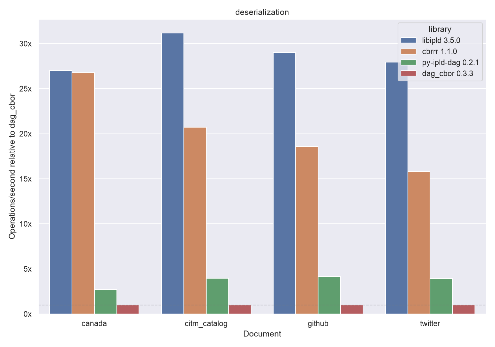
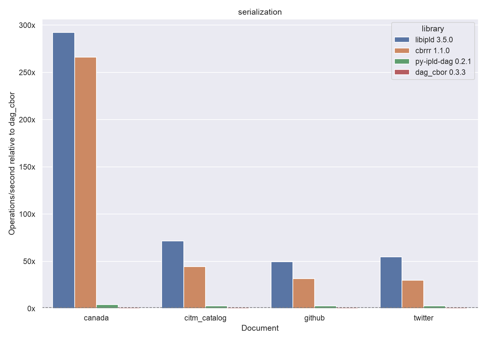

## Python IPLD

> This project aims to speed up [The AT Protocol SDK](https://github.com/MarshalX/atproto) by using Rust for the heavy lifting. Only atproto related parts are implemented first.

Code snippet:

```python
import libipld

# CID
cid = libipld.CID('bafyreig7jbijxpn4lfhvnvyuwf5u5jyhd7begxwyiqe7ingwxycjdqjjoa')
print(cid.version, cid.codec, bytes(cid).hex())
# Output: 1 113 01711220df48509bbdbc594f56d714b17b4ea7071fc2435ed84409f434d6be0491c12970
print(libipld.decode_cid('bafyreig7jbijxpn4lfhvnvyuwf5u5jyhd7begxwyiqe7ingwxycjdqjjoa'))
# Output: {'hash': {'size': 32, 'code': 18, 'digest': b'\xdfHP\x9b\xbd\xbcYOV\xd7\x14\xb1{N\xa7\x07\x1f\xc2C^\xd8D\t\xf44\xd6\xbe\x04\x91\xc1)p'}, 'version': 1, 'codec': 113}
print(libipld.encode_cid(bytes.fromhex('01711220b6811a1d7f8c1791da6d1b4f136dc0e22679eafeaa58d64d7e2faad5890e9d9c')))
# Output: bafyreifwqenb274mc6i5u3i3j4jw3qhcez46v7vkldle27rpvlkysdu5tq

# DAG-CBOR
print(libipld.decode_dag_cbor(b'\xa2aa\x0cabfhello!'))
# Output: {'a': 12, 'b': 'hello!'}
print(libipld.encode_dag_cbor({'a': 12, 'b': 'hello!'}))
# Output: b'\xa2aa\x0cabfhello!'
print(libipld.decode_dag_cbor(libipld.encode_dag_cbor({'link': cid})))
# Output: {'link': CID('bafyreig7jbijxpn4lfhvnvyuwf5u5jyhd7begxwyiqe7ingwxycjdqjjoa')}

# multibase
print(libipld.decode_multibase('ueWVzIG1hbmkgIQ'))
# Output: ('u', b'yes mani !')
print(libipld.encode_multibase('u', b'yes mani !'))
# Output: ueWVzIG1hbmkgIQ
```

### Features

#### 🔗 CID (Content Identifier) Operations
- **`CID(data: str | bytes)`** - Immutable CID from its string or binary form, with `version`, `codec`, `hash`, `str(cid)` and `bytes(cid)`
- **`decode_cid(data: str | bytes | CID) -> dict[str, Any]`** - Decode CIDs from string representation (e.g., `'bafy...'`) or raw bytes into structured data containing version, codec, and hash information
- **`encode_cid(data: str | bytes | CID) -> str`** - Encode CID raw bytes to string representation, or return string CIDs as-is

#### 📦 DAG-CBOR (Directed Acyclic Graph CBOR) Operations  
- **`decode_dag_cbor(data: bytes, *, canonical: bool = False) -> Any`** - Decode DAG-CBOR binary data into Python objects (dicts, lists, primitives, `CID` for links)
- **`decode_dag_cbor_multi(data: bytes, *, canonical: bool = False) -> list[Any]`** - Decode multiple concatenated DAG-CBOR objects from a single byte stream
- **`encode_dag_cbor(data: Any) -> bytes`** - Encode Python objects into DAG-CBOR binary format

#### 🌐 Multibase Operations
- **`decode_multibase(data: str) -> tuple[str, bytes]`** - Decode multibase-encoded strings, returning the base identifier and decoded data
- **`encode_multibase(code: str, data: str | bytes) -> str`** - Encode data using specified multibase encoding (e.g. `'u'` for base64url)

#### 🚗 CAR (Content Addressable Archives) Operations
- **`decode_car(data: bytes) -> tuple[dict[str, Any], dict[CID, dict[str, Any]]]`** - Decode CAR files into header metadata and a mapping of block CIDs to block data

### Error handling

Every function raises `ValueError` for input it cannot decode or encode. The message starts with the failing operation (for example `Failed to read CAR block.`) followed by the reason.

The DAG-CBOR and CAR functions additionally raise `RecursionError` when the data is nested deeper than `sys.getrecursionlimit()`.

Inputs are validated strictly against the specifications. There is no option to skip validation or accept partially broken data. Data produced by third-party encoders is not always valid, so consumers of untrusted input (for example the AT Protocol firehose) should be prepared to catch `ValueError` per message and skip it.

```python
import libipld

try:
    header, blocks = libipld.decode_car(data)
except ValueError as e:
    print(f'skipping malformed CAR: {e}')
except RecursionError:
    print('skipping CAR with excessively nested block')
```

Passing a value of the wrong type, such as a `str` where `bytes` is expected, raises `TypeError`.

### Links and canonical form

Links decode to `CID`, and `encode_dag_cbor` writes a `CID` as a link and `bytes` as a byte string, so canonical data round-trips byte-exact. `canonical=True` rejects data in any other form:

```python
value = libipld.decode_dag_cbor(data, canonical=True)
assert libipld.encode_dag_cbor(value) == data
```

A `CID` equals only another `CID`: compare with a string as `cid == libipld.CID(s)`.

### Requirements

- Python 3.8 or higher.

Prebuilt wheels are published for CPython 3.8-3.15, free-threaded CPython 3.14t and 3.15t, and PyPy 3.11.

### Installing

You can install or upgrade `libipld` via

```bash
pip install -U libipld
```

### Performance

Benchmarks against [`cbrrr`](https://github.com/DavidBuchanan314/dag-cbrrr) (C), [`py-ipld-dag`](https://github.com/ipld/py-ipld-dag) (Python wrapper over Rust-backed [`cbor2`](https://github.com/agronholm/cbor2)) and [`dag_cbor`](https://github.com/hashberg-io/dag-cbor) (pure Python), measured on the four classic [nativejson-benchmark](https://github.com/miloyip/nativejson-benchmark) fixtures (round-tripped through DAG-CBOR). Bars are operations/second relative to pure-Python `dag_cbor`; higher is better.

Measured on Apple M1, macOS 27, CPython 3.14.0, `libipld` installed from PyPI (PGO + LTO wheel).

#### Deserialization



#### Serialization



Reproduce locally:

```bash
cd benchmark && ./run.sh
```

See [`benchmark/README.md`](./benchmark/README.md) for details.

### Changelog

See [`CHANGES.md`](./CHANGES.md) for release notes.

### Contributing

Contributions of all sizes are welcome. See [`CONTRIBUTING.md`](./CONTRIBUTING.md) for setup, build, test, and benchmarking workflow.

### License

MIT – see [LICENSE](./LICENSE).
